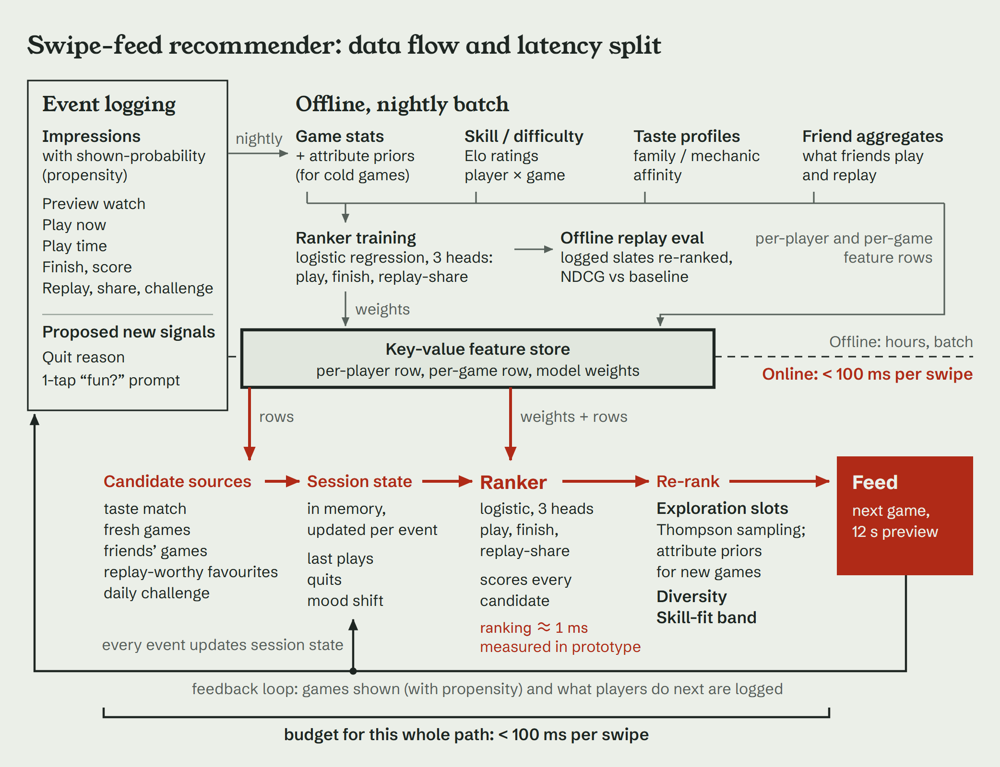

# Game recommendations for Atoms

Atoms shows a 12 s preview, and the player either swipes or taps Play now for a 1 to 3 minute game of skill. Two players can tap the same preview and have opposite experiences, so a quit can mean "too hard" as easily as "not for me".

<!-- card -->
**Taste decides what gets started; fit decides what gets finished, and an offline score built on the old feed's slates mostly sees the first.** My ranker beats popularity by +0.1178 NDCG@5, a score for how well the top five slots match what the player went on to do (95% confidence interval or CI, the likely range of the true gain, +0.0921 to +0.1446). Almost all of it comes from family and mechanic taste. Fit, meaning how a game's difficulty meets a player, shows mostly on the game side: my player and game rating adds only +0.0074 AUC (the chance of ranking a finisher above a non-finisher) over the game's own finish rate, with a lower bound of 0.0000.

## Research

<!-- card -->
- Rate players and games together. Duolingo's Birdbrain (IEEE Spectrum, secondary) and Lichess puzzles update ability and difficulty after each attempt, a generalisation of Elo, the chess rating that moves most after an upset. On Atoms a player who finishes a game the model expected them to fail gains rating, and the game's difficulty falls. The prototype uses Pelánek's version, whose updates shrink as plays add up; Glicko-2 wants 10 to 15 games per rating period, more than most players log.
- Predict each step from preview to finish, and judge a finish against similar players. YouTube's multitask ranker and Instagram's Explore combine several predicted outcomes, and Kuaishou's D2Q compares watch time among videos of similar length; on Atoms I would compare players of similar skill. The prototype predicts three outcomes but has no skill groups.
- For new games, use Thompson sampling, which shows each game in proportion to its chance of being the best, and log each card's propensity, its probability of being shown. One Beta distribution per game needs little tuning (Chapelle and Li), and a new game's uncertain starting guess earns it trial slots without a quota. Logged propensities, which YouTube uses to correct for feed bias, would let me score new rankers on future logs. I have not built it.

## Player behaviour

Numbers come from `research/eda-report.md`. Each card shown (an impression) gets an outcome from 0 to 3.

<!-- figure: What players do after a preview. One horizontal stacked bar (or four bars) of the share of training impressions by outcome: 0 = no play or under 20 s, 86.8%; 1 = played 20 s or more, 4.7%; 2 = finished, 4.0%; 3 = replayed, shared or challenged, 4.5%. n = 67,452 impressions. Source: research/eda-report.md section 3, "train all" column; outcome definitions from data/README.md. -->

Scores below are how often a signal ranks the better of two games in a slate (the set a session was shown) first; 0.5 means no information.

### Preference

Family taste is the strongest signal (0.636 on validation), ahead of popularity (0.574), average preview watch (0.576) and friends (0.531). A game finished before has an average outcome of 0.478 when it returns, against 0.221 for one seen but never played for 20 s. Against a favourites trap, taste shrinks toward the average for players with few plays, a calibrated re-rank (Steck) keeps the family mix close to history, and exploration slots add other games.

### Watching versus playing

The tap rate rises from about 4% at 1 to 2 s of watch to 36 to 46% at 8 s or more, while the quit rate after a tap falls only from 15% to 10%. A game with a high preview-to-play rate and a low play-to-finish rate has a preview that oversells.

### Mood

Session state counts plays, quits and skips by family and outweighs the long-run profile once 2 or more skips or quits in a row hit one family. The first three games (the prefix) matter little (0.530), and a prefix quit showed no penalty for its family (0.348 against 0.208 for absent families, n=89).

### Noise

Low-skill players quit 26% of hard games (difficulty 4 to 5) and 9% of easy ones, against 10% and 7% for high-skill players, so I read quits through the skill model. The old feed showed 5-star games at 1.58 times their share and 1-star games at 0.47, so I pull every rate toward an average. I would also log a one-tap "fun?" prompt after 1 in 10 plays, a sampled quit reason and full preview watches.

## Design

### Players and games

A player is taste per family and mechanic, a skill rating, friends' plays and session state. A game is its attributes, its outcome rates and its learned difficulty.

### Ranking

At 500 games, growing 10 times this year, I can score everything: 200 games take 2.28 ms at p50 (the median) and 4.71 ms at p99 (the slowest 1 in 100). Candidate sources guarantee taste matches, fresh games and friends' games. A logistic model predicts P(play), P(finish) and P(replay, share or challenge), combined as expected gain. Two engineers can read every weight, and embeddings would be weakest on new games and thin players. A re-rank adds exploration, calibrates the family mix and keeps most slots in a target band of predicted success.

### Exploration and cold start

Exploration starts at 1 slot in 10, an A/B parameter. A brand-new player gets popular mid-difficulty games and friends' games, then reactions to their first plays; for cold users (2 sessions or fewer) friend play (0.541) is about as strong as thin family taste (0.553). Their rating starts at the average with large steps. A new game gets its starting guess and a place in the exploration pool.

| Where | What | How often |
|---|---|---|
| Offline | game stats and starting guesses, Elo ratings, taste profiles, friend counts, ranker training, new-game success estimates | nightly (new-game estimates hourly) |
| Stored | key-value rows per player and per game, model weights, impression log with propensity | |
| Online | session state on every event, scoring, re-rank, choosing the next card | under 100 ms per swipe |

The online path reads session features on every request, so ranking adapts within a session.

## Prototype

The code is at github.com/MananBafna/atoms-recommender, and one command rebuilds every number (`prototype/README.md`). The live demo at atoms-ranking-replay.vercel.app shows 40 validation sessions ranked both ways.

<!-- card -->
Features for a session use only events before it, plus its own three-game prefix. Validation features never read `val_events.csv`, which holds the validation outcomes.

I train on practice sessions from training days 7 to 19 and chose the model on days 20 to 23 (the holdout). For `submission/rankings_test.csv` I refit the chosen model on train plus `val_events`, with test features built only from earlier events. Nothing was tuned on test.

### Results

The lift on slates with a brand-new game comes from their other games (only 25 new-game rows are relevant).

<!-- figure: Gain over popularity by player group, validation. Horizontal bars of the NDCG@5 difference (ours minus popularity) with the 95% paired-bootstrap range drawn as a pale band behind each bar, and a zero line. Label each bar with sessions, ours and popularity. All scored sessions: n 604, 0.5209 vs 0.4032, +0.1178 [+0.0921, +0.1446]. Cold users (2 sessions or fewer): n 110, 0.4199 vs 0.3800, +0.0400 [-0.0084, +0.0893]. Slate has a brand-new game: n 152, 0.5187 vs 0.3824, +0.1363 [+0.0791, +0.1940]. First three games included a play: n 240, 0.5058 vs 0.3676, +0.1382 [+0.0988, +0.1781]. First three games had no play: n 364, 0.5309 vs 0.4266, +0.1043 [+0.0687, +0.1403]. Source: prototype/out/metrics.json keys "bootstrap" and "slices". -->

### Where the lift comes from

Giving each validation session another session's player drops NDCG@5 to 0.3721, below game quality and starting guesses alone (0.4137).

<!-- figure: What each signal adds. Horizontal bars of holdout NDCG@5 lost when one feature group is dropped (full model 0.5258, 684 sessions), sorted, with the 95% range as a pale band and a zero line. Plain labels (metrics key in brackets): taste for family and mechanic (affinity) +0.0885 [+0.0666, +0.1094]; game quality (quality) +0.0085 [-0.0060, +0.0228]; friends (friends) +0.0040 [-0.0031, +0.0109]; starting guess from attributes (prior) +0.0020 [-0.0049, +0.0085]; past plays of this game (repeat) +0.0004 [-0.0059, +0.0066]; first three games of the session (prefix) -0.0006 [-0.0069, +0.0061]; skill rating (skill) -0.0015 [-0.0070, +0.0044]. Source: prototype/out/metrics.json key "holdout_leave_one_group_out". -->

### Skill model

On 1,652 tapped holdout rows the rating improves finish prediction by +0.0197 AUC, but the game's own finish rate does as well, so the rating mostly predicts game difficulty.

<!-- figure: Skill versus game difficulty for predicting finishes. Four vertical bars of completion AUC on 1,652 tapped holdout rows, axis starting at 0.60 (as design/doc/charts.py draws it) and labelled as cut: family taste 0.6647; family taste + player and game rating 0.6844; family taste + game finish rate 0.6849; family taste + game finish rate + rating 0.6923. Annotate the two gains with 95% ranges: +0.0197 [+0.0045, +0.0339] and +0.0074 [+0.0000, +0.0150]. Source: prototype/out/metrics.json key "skill_analysis.completion_auc_decomposition". -->

On the 134 holdout sessions where a low-rated player had a difficulty 4 or 5 game, the full model beats the no-skill model by +0.0029 (CI -0.0124 to +0.0177), and the success-chance weight is slightly negative. Quality features already carry the finish rate, and the label scores a quit like a skip, so avoiding likely quits earns little offline. I keep the rating because it costs one nightly job and can be tested online.

### Where it fails

<!-- card -->
- Cold users gain +0.0400 and the CI includes zero.
- The starting guess from family and mechanic gives no gain. With the history of 30 games hidden, the 575 affected holdout sessions score 0.4986 with the guess and 0.4990 with global rates (from all of train, so not strictly limited to earlier events), against 0.5112 with full history.
- In 7 of the 10 sessions I lose most, a taste feature put an ignored game on top.
- Test has about twice validation's share of slate rows from brand-new games (4.7% against 2.2%), so validation under-tests cold start.

## Measuring quality

<!-- card -->
**Primary metric: satisfying plays per 10 impressions served**, where a satisfying play is a finish, replay, share or challenge. It needs both a tap (discovery) and a finish (fit), and dividing by cards shown penalises slots wasted on skipped or abandoned games.

| Supporting metric | Why |
|---|---|
| Play-start rate (taps per impression) | discovery; next to the primary, it exposes previews that lead nowhere |
| Skill-adjusted completion (against the expected rate for players of that skill on that game) | fit, without easy games winning by default |
| Replays, shares and challenges per play | enjoyment and the social loop |
| D7 return (share of players back on day 7) | the decision metric for launches |
| New-game coverage in the first week | cold start |

Guardrails are the early-quit rate and the difficulty mix of plays against control.

### Beating a baseline

Offline I use the paired bootstrap on logged slates, then, once propensities exist, capped inverse-propensity estimates. Online I would mix both rankers' picks in one feed (Gomez-Uribe and Hunt), then A/B test. A 1 point change on a 10% base (two-proportion test, alpha 0.05, power 0.8) needs about 15,000 players per arm, so at 50,000 monthly players I would test only large changes.

### Gaming risk

Completion falls from 69% at difficulty 1 to 46% at difficulty 5, so a ranker could raise the metric with trivial games that bore strong players. Skill-adjusted completion catches this, the difficulty guardrail limits it, and a change that lifts satisfying plays but lowers D7 return does not ship.

### Why offline NDCG is weak

The slates are the old feed's picks, so NDCG ignores games it never showed. The label counts any play of 20 s or more, so an abandoned hard game still scores (see Prototype). In validation, 26% of sessions have no relevant game, and with 604 scored sessions a difference of 0.01 is noise.

## Judgment

### What I would not build first

I would skip embeddings and play-order models, since at 500 games I can score everything; training on every event, since nightly jobs and session features cover the drift I see; and Glicko-2 (see Research).

### What I am least sure about

I am least sure whether skill fit improves how the feed feels. My success band (0.55 to 0.80) sits below the 85% figure that learning research derived in simulation, and flow research finds challenge-skill balance explains little of reported enjoyment, so I would A/B test the band.

### Where AI tools got something wrong

AI tools got four things wrong:

- The design doc led with "a quit is fit, not taste" before the drop-one test showed skill adds nothing to NDCG, so I rewrote it.
- A generated label said a game "matches their skill level", while the ranker favours lower predicted success. Checking labels against weight signs, I changed it to "a stretch for their skill".
- TikTok, Netflix, Roblox and some ACM pages failed to load, so I marked mirror copies secondary and cited nothing from Roblox.
- Reused on pandas rows, the official labelling helper turned a blank play time into NaN, so a tap with no play time counted as a play. I wrote a table-wide labeller and a test that it matches `common.relevance` on every `val_prefix` row.

## References

- Zhao et al. Recommending What Video to Watch Next: A Multitask Ranking System. 2019 (secondary). https://daiwk.github.io/assets/youtube-multitask.pdf
- Meta. Scaling the Instagram Explore recommendations system. 2023. https://engineering.fb.com/2023/08/09/ml-applications/scaling-instagram-explore-recommendations-system/
- Zhan et al. Deconfounding Duration Bias in Watch-time Prediction for Video Recommendation. 2022. https://arxiv.org/abs/2206.06003
- Netflix. Artwork Personalization at Netflix (slides). https://www.slideshare.net/slideshow/artwork-personalization-at-netflix/121997305
- Chapelle, Li. An Empirical Evaluation of Thompson Sampling. 2011. https://proceedings.nips.cc/paper_files/paper/2011/file/e53a0a2978c28872a4505bdb51db06dc-Paper.pdf
- Chen et al. Top-K Off-Policy Correction for a REINFORCE Recommender System. 2019. https://arxiv.org/abs/1812.02353
- Steck. Calibrated Recommendations. 2018. https://salanghei.github.io/download/paper/CalibratedRecommendations.pdf
- Gomez-Uribe, Hunt. The Netflix Recommender System. 2015 (secondary). https://gwern.net/doc/reinforcement-learning/exploration/2015-gomezuribe.pdf
- IEEE Spectrum. Article on Duolingo's lesson personalization (secondary). https://spectrum.ieee.org/duolingo
- Lichess. PuzzleFinisher.scala (secondary). https://github.com/lichess-org/lila/blob/master/modules/puzzle/src/main/PuzzleFinisher.scala
- Pelánek. Applications of the Elo rating system in adaptive educational systems. 2016. https://www.fi.muni.cz/~xpelanek/publications/CAE-elo.pdf
- Glickman. Example of the Glicko-2 system. 2022. http://www.glicko.net/glicko/glicko2.pdf
- Wilson et al. The Eighty Five Percent Rule for optimal learning. 2019. https://pmc.ncbi.nlm.nih.gov/articles/PMC6831579
- Frontiers in Psychology. Review of flow research (secondary). 2020. https://www.frontiersin.org/articles/10.3389/fpsyg.2020.00158/full
